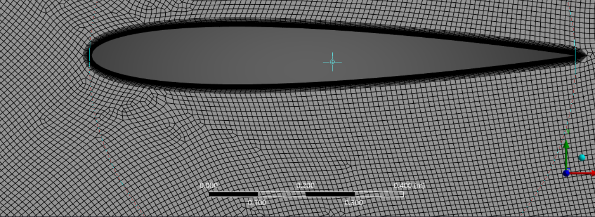
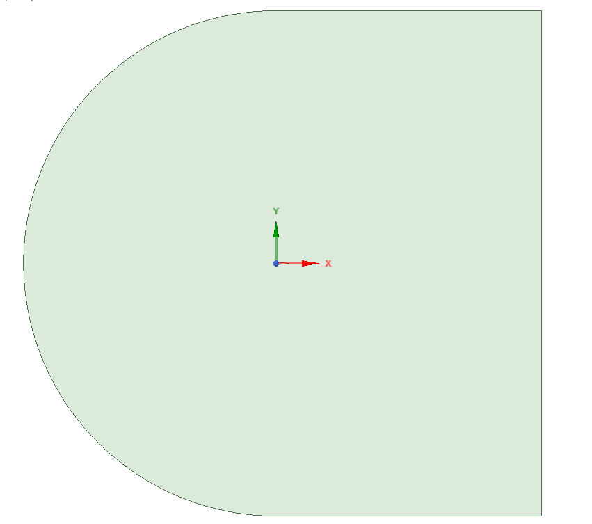
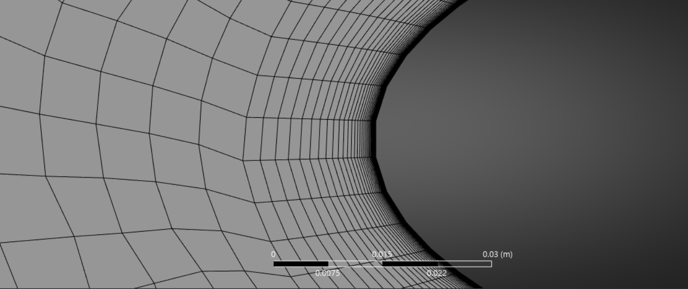
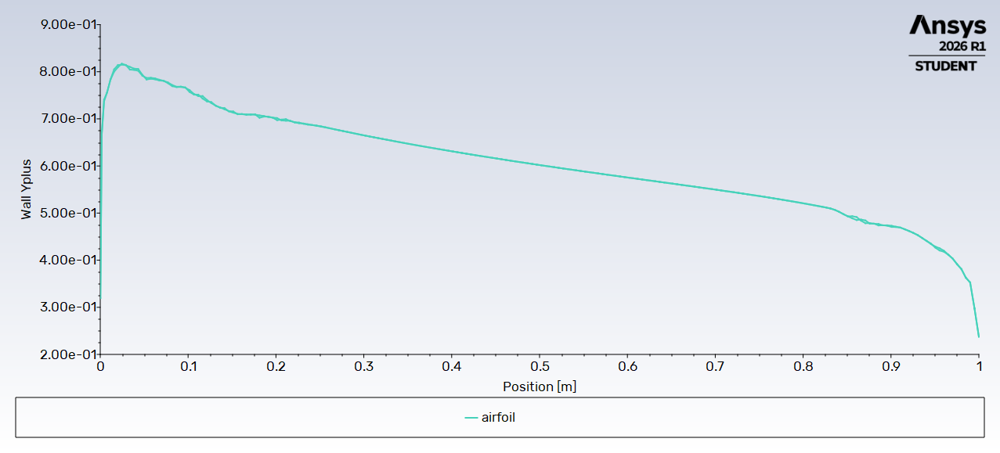
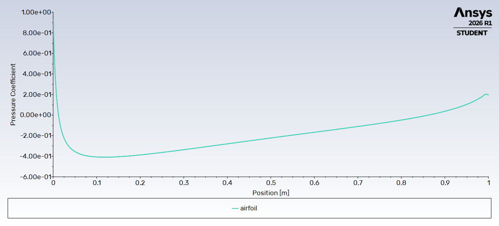

# NACA 0012 Airfoil — Turbulent RANS Simulation at Low Incidence (ANSYS Fluent)

2D steady RANS simulation (k-ω SST) of the NACA 0012 airfoil at Re = 6 × 10⁶, Mach 0.15. At α = 0° and 5°, the results agree with reference data: **zero-lift drag within ~4 % of NASA reference values** and **lift slope within ~2 % of thin-airfoil theory**, with a wall-resolved boundary layer (y⁺ < 1).



---

## 1. Objective

Validate an external-aerodynamics CFD workflow on a classical turbulent case: scripted geometry, boundary-layer meshing for a wall-resolved turbulence model, y⁺ control, and force analysis (lift, drag, pressure/friction decomposition).

The NACA 0012 at Re = 6 × 10⁶ is a standard validation case of the NASA Turbulence Modeling Resource (TMR), with wind-tunnel data from Ladson (1988).

---

## 2. Problem Setup

| Parameter | Value |
|---|---|
| Airfoil | NACA 0012, chord c = 1 m |
| Freestream velocity | U∞ = 51.04 m/s (Mach 0.15 at 288 K) |
| Density | ρ = 1.225 kg/m³ (constant, incompressible) |
| Viscosity | μ = 1.042 × 10⁻⁵ Pa·s (adjusted) |
| Reynolds number | Re = 6 × 10⁶ |
| Turbulence model | k-ω SST, fully turbulent |

**Reynolds and Mach similarity.** With c = 1 m and real air viscosity, Re = 6 × 10⁶ would require 87 m/s (Mach 0.26), adding compressibility effects absent from the reference case. The velocity is therefore set to match the Mach number, and the viscosity is adjusted (μ = ρU∞c/Re) to match the Reynolds number.

---

## 3. Geometry



- Airfoil generated from the analytical NACA 4-digit thickness law (`scripts/naca0012_points.py`), 399 points with cosine clustering at the leading and trailing edges, closed trailing edge (last coefficient −0.1036, as in the NASA TMR geometry).
- C-shaped domain (`scripts/naca0012_domain.py`): half-circle of radius 20c ahead of the airfoil, wake region extending 20c behind the trailing edge.
- Both curves are imported into SpaceClaim from point files; the fluid surface is obtained by subtracting the airfoil from the domain.

---

## 4. Mesh

| Setting | Value |
|---|---|
| Type | Unstructured quad-dominant + prism inflation layers |
| Airfoil surface spacing | 2 mm (~1 000 cells around the airfoil) |
| Refinement zone | Sphere of influence, radius 1.5c, 1 cm cells |
| First layer height | 5 µm |
| Inflation | 45 layers, growth rate 1.15 (~18 mm total, covers the boundary layer) |
| Far field | 1 m cells, growth rate 1.05 |
| Total | ~108 500 cells |



**First-cell height.** Estimated from a flat-plate skin-friction correlation (Cf ≈ 0.0028, u_τ ≈ 1.9 m/s) so that y⁺ < 1, as required by the SST model to resolve the viscous sublayer without wall functions.



y⁺ stays between 0.25 and 0.82 over the whole airfoil: the viscous sublayer is resolved.

---

## 5. Numerical Setup

| Setting | Choice |
|---|---|
| Solver | Pressure-based, steady, double precision |
| Coupling / schemes | Coupled (pseudo-transient), second order |
| Inlet (arc + top + bottom) | Velocity inlet, components set by α; Tu = 1 %, μt/μ = 10 |
| Outlet | Pressure outlet, 0 Pa gauge |
| Airfoil | No-slip wall |
| Angle of attack | Imposed through the inlet velocity direction; lift and drag vectors rotated accordingly |

---

## 6. Results



At α = 0°: Cp = 1 at the stagnation point (confirms reference values), suction peak Cp ≈ −0.41 near x/c ≈ 0.12, upper and lower distributions superimposed (symmetric flow).

| α | Cl | Cd total | Cd pressure | Cd friction |
|---|---|---|---|---|
| 0° | 0.0004 | 0.00841 | 0.00206 | 0.00635 |
| 5° | 0.538 | 0.01062 | 0.00453 | 0.00609 |

### Comparison with references

| Quantity | CFD | Reference | Deviation |
|---|---|---|---|
| Cd at α = 0° | 0.00841 | ≈ 0.0081 (NASA TMR, SST) | ~4 % |
| Lift slope (0–5°) | 0.108 /deg | 2π rad⁻¹ = 0.110 /deg (thin-airfoil theory) | ~2 % |
| Cl at α = 0° | 0.0004 | 0 (symmetric airfoil) | — |

At α = 0°, about 75 % of the drag comes from skin friction, as expected for a thin airfoil at zero incidence.

---

## 7. Limitations & Next Steps

- **Higher incidence not validated.** At α = 10°, the refined mesh predicts a lift coefficient about 10 % below the reference with a strongly overestimated pressure drag, the signature of a non-physical suction-side separation. The cause is not yet identified; the polar is therefore limited to α ≤ 5°.
- **Drag at α = 5°.** The pressure-drag share grows with lift; candidate causes are the far-field distance (20c with velocity boundary conditions constraining the circulation) and the unstructured mesh resolution.
- **Trailing edge.** The sharp trailing edge produces a few degenerate inflation cells at the tip (minimum orthogonal quality ~10⁻⁴). Their effect on the forces is negligible at α = 0°; a blunt trailing edge (standard NACA definition) would remove them.
- **Next steps:** structured C-mesh, larger far-field (≥ 100c) or pressure-far-field conditions, mesh-convergence study, full polar up to stall.

---

## Repository Structure

```
├── README.md
├── images/     Geometry, mesh, y+, pressure coefficient
├── data/       Fluent XY exports (Cp, y+), if available
└── scripts/    naca0012_points.py, naca0012_domain.py — SpaceClaim point-curve generators
```

## References

- Ladson C.L. (1988). *Effects of Independent Variation of Mach and Reynolds Numbers on the Low-Speed Aerodynamic Characteristics of the NACA 0012 Airfoil Section*. NASA TM-4074.
- NASA Langley Turbulence Modeling Resource — 2D NACA 0012 Airfoil Validation Case.
- Menter F.R. (1994). *Two-Equation Eddy-Viscosity Turbulence Models for Engineering Applications*. AIAA Journal, 32(8).

## Tools

ANSYS Student 2026 R1 (SpaceClaim, Meshing, Fluent) · Python (NumPy)

---

**Author:** Yanis Boutabia — Aerospace Engineering student (Aerospace Vehicles, Energy & Propulsion), IPSA Paris
